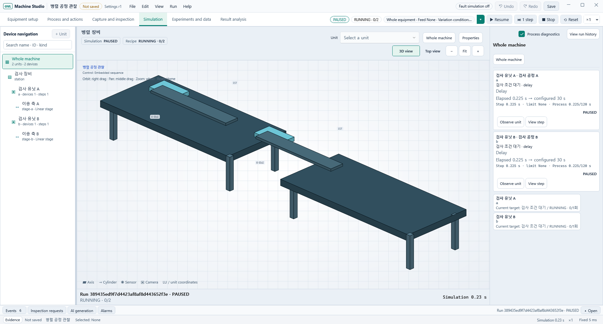
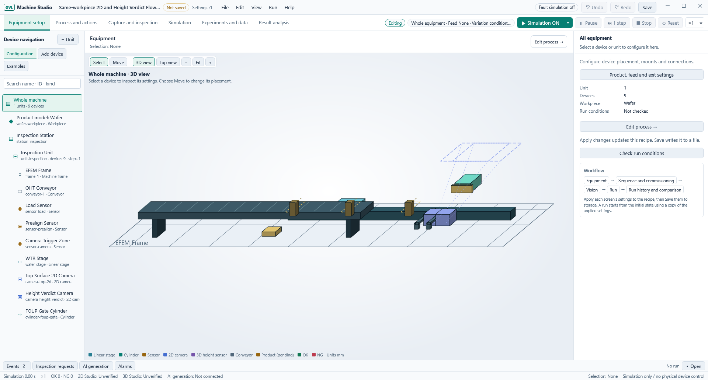
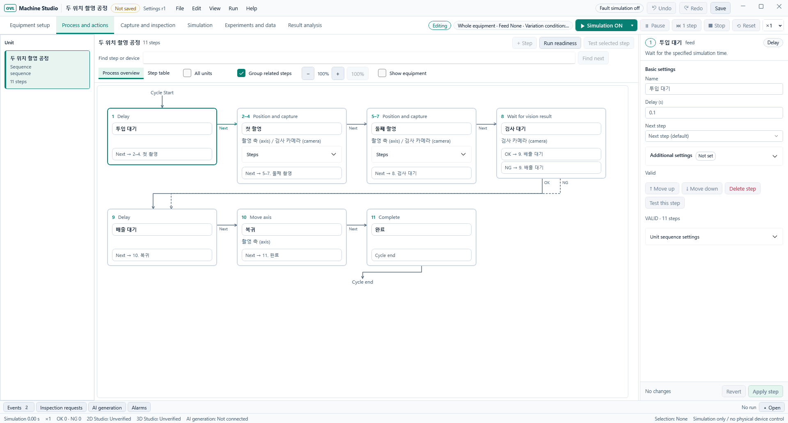
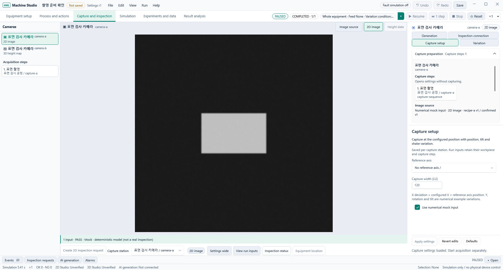
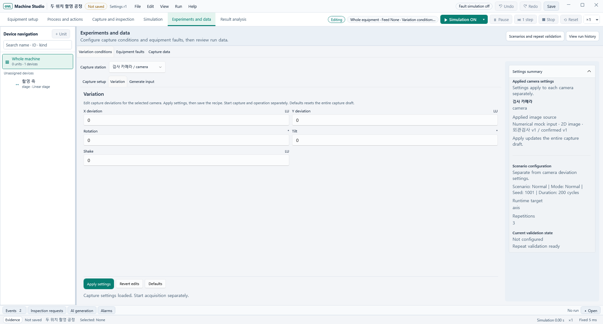
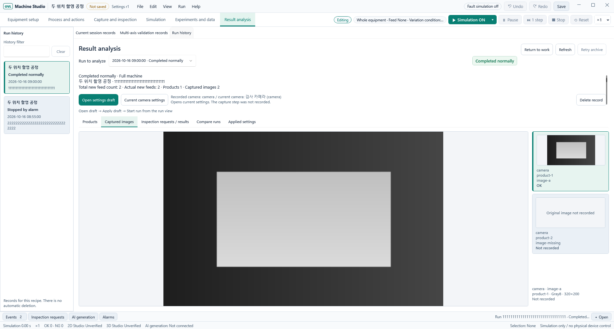

# OpenVisionLab Machine Studio

**Configure a virtual machine, write its control sequence, and check machine behavior before hardware commissioning.**

Machine Studio is a Windows desktop application for control and machine-vision
engineers. Arrange conveyors, axes, sensors, cylinders and virtual cameras;
define their signals and sequences; then inspect motion, interlocks, acquisition
and inspection results in the same project.

[](https://github.com/Noah8218/OpenVisionLab-Machine-Studio/actions/workflows/fault-scenario-headless-smoke.yml)
  [](LICENSE)

English | [한국어](README.ko.md)



[Equipment setup](#equipment-setup) · [Process and actions](#process-and-actions) · [Capture and inspection](#capture-and-inspection) · [Simulation](#simulation) · [Experiments and data](#experiments-and-data) · [Result analysis](#result-analysis)

## Try it in 3 steps

1. Clone `https://github.com/Noah8218/OpenVisionLab-Machine-Studio.git` and enter the repository directory.
2. [Build and run Machine Studio](#build-from-source).
3. Open **Automatic Transfer Cell** from the start screen and save a copy before editing. Follow the [example workflow](docs/USER_GUIDE.md#start-with-an-example) to check devices, sequence targets and acquisition settings, then run the Simulation.

**Apply** updates the relevant settings or step in the working project.
**Save** writes the project file. Starting a run is a separate action. Loading
a project, selecting a device or browsing results does not run the machine.

## What it does

- Arrange equipment, devices and DI/DO connections.
- Author sequences with explicit targets, waiting conditions and applied step settings.
- Acquire test images, run simulations and inspect faults, scenario checks and records.
- Run basic local simulations without a cloud account.

## Equipment setup



Create stations and units, add devices, and configure their placement and connections.
The equipment tree and scene share the same selection.
Top and oblique views show the same layout; the oblique view is schematic, not a CAD or contact-physics model.

## Process and actions



Review sequence steps, branches and connections, then select the target for each action.
Apply step drafts explicitly; reviewing a teaching position does not move an axis.
See the [user guide](docs/USER_GUIDE.md#process-and-actions) for supported step types and linear-sequence editing limits.

## Capture and inspection



Select a virtual camera, configure its source and acquire an image explicitly.
Preparation details distinguish the selected Recipe from the Recipe, image ID and result used by the current acquisition.
See the [user guide](docs/USER_GUIDE.md#capture-and-inspection) for supported inputs, external inspection requirements and built-in deterministic judgments for control-flow testing.

## Simulation


Start, pause, resume, step or reset the authored machine and inspect runtime state.
The fixed 5 ms tick is simulation time, not a hard real-time scheduling guarantee.
End a run before changing equipment; pausing retains the current run and does not apply edited definitions.

## Experiments and data



Edit camera variations and explicitly apply acquisition settings.
Choose a scenario and repetition count, then run validation and inspect its status.
Activate or clear faults for an explicit runtime target; faults belong to the current session and are not saved as Recipe settings.

## Result analysis



Open a recorded run or compare two records from the same Recipe, selecting acquisitions explicitly.
Open a recorded camera's current settings, then return to the selected record; missing step identity is not inferred from its name or order.
Opening a record or restoring settings does not start a run, acquire an image or apply a result.

See the [user guide](docs/USER_GUIDE.md) for workspace details, sample projects, fault types and screenshot conditions.

## Works with OpenVisionLab

Compatible external inspection applications are supported through connection settings.
Direct workflows with [2D Workbench](https://github.com/Noah8218/OpenVisionLab),
[3D Studio](https://github.com/Noah8218/OpenVisionLab-3D-Studio) and
[Labeling Studio](https://github.com/Noah8218/OpenVisionLab-Labeling-Studio) remain in development.

## Build from source

Requirements: Windows 10 or later, the .NET 8 SDK, and Git. Visual Studio users
can open `OpenVisionLab.MachineStudio.sln` and select
`OpenVisionLab.MachineStudio` as the startup project.

From the repository root:

```powershell
dotnet build OpenVisionLab.MachineStudio.sln -c Release
dotnet run --project src/OpenVisionLab.MachineStudio/OpenVisionLab.MachineStudio.csproj -c Release --no-build
```

The pinned integration packages are included in the local NuGet feed. See
[the dependency notes](third_party/OpenVisionLabIntegrationContracts/README.md)
for their versions and licenses. A source build does not establish compatibility
with an arbitrary installed inspection application.

## Documentation

[User guide](docs/USER_GUIDE.md) · [Architecture](docs/ARCHITECTURE.md) · [Semiconductor equipment examples](samples/SemiconductorRecipes/README.md)

Current version: `v0.2.0-dev.81` · [Changelog](CHANGELOG.md)

## Development status

This is an actively developed, hardware-free simulation environment. It is not
qualified for production equipment control or safety functions.

This development version includes equipment authoring, sequence editing,
virtual acquisition, simulation, scenario checks and run analysis. Full desktop
interaction, all themes and scaling combinations, restart behavior and
production performance are still being qualified. Use copies of important
projects when evaluating it.

Real PLC, robot and camera control, safety control, MES/cloud operation,
CAD authoring, calibrated physical simulation and production AI inspection
are outside the current supported scope. Height data is numerical test data;
it is not evidence of a calibrated 3D measurement system. Image-set generation,
review and retention are not presented as a completed workflow.

## Part of OpenVisionLab

| Project | What it does |
| --- | --- |
| [2D Workbench](https://github.com/Noah8218/OpenVisionLab) | Rule-based 2D inspection Recipes |
| [3D Studio](https://github.com/Noah8218/OpenVisionLab-3D-Studio) | 3D teaching, Thickness and Warpage |
| [Labeling Studio](https://github.com/Noah8218/OpenVisionLab-Labeling-Studio) | Labeling, training and model comparison |
| [Machine Studio](https://github.com/Noah8218/OpenVisionLab-Machine-Studio) | Machine simulation before hardware |
| [Vision SDK](https://github.com/Noah8218/OpenVisionLab-Vision-SDK) | Shared C# inspection library |

## Contributing and licensing

For source ownership and build guidance, see [Architecture](docs/ARCHITECTURE.md).
Follow [Contributing](CONTRIBUTING.md) for changes and include the version,
reproduction steps and relevant layout/scaling information with UI reports.
Remove customer data and credentials from shared projects.

[Support](SUPPORT.md) · [Security reporting](SECURITY.md) ·
[Code of conduct](CODE_OF_CONDUCT.md)

Machine Studio is available under the [MIT License](LICENSE). See
[NOTICE](NOTICE), [third-party notices](THIRD-PARTY-NOTICES.md) and
[asset provenance](ASSET-PROVENANCE.json) for attribution. The project is
vendor-neutral and is not affiliated with an equipment manufacturer.
